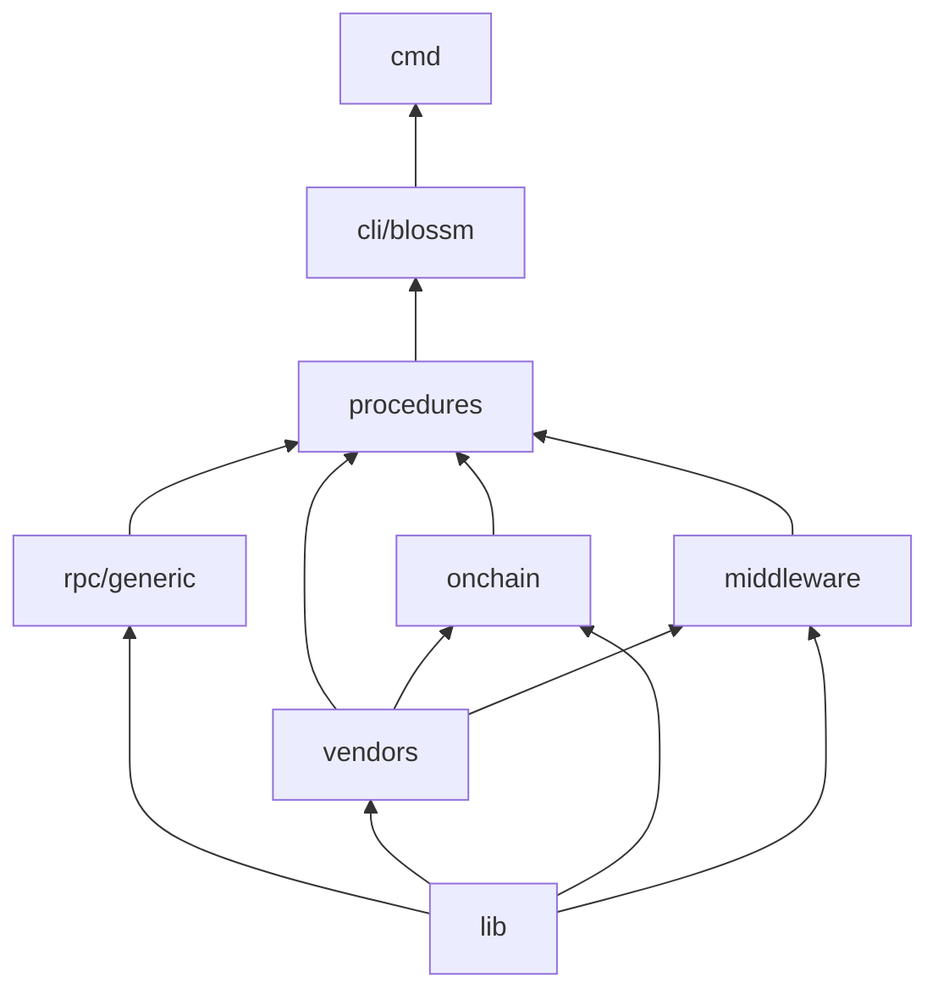

# Familiar names and dependency layers

Toolbox restores the JavaScript repository's useful folder vocabulary while
keeping cohesive Go packages in one framework module. The 154 retained package
identities remain in the [capability inventory](capabilities.md); they do not
become 154 separately versioned Go modules. Dia remains an independent application
and owns its domain models, policy, runtime and executable examples.

## Layer direction

The arrows below mean **provides capabilities to**, from lower to higher layers.
Imports point in the reverse direction: a consumer imports an allowed lower
layer. The diagram is a layer overview, not permission for arbitrary imports
between sibling packages; the owning checker defines the precise allowed edges.

`lib` is the bottom layer. Within the Toolbox module, a lib package may import
only other lib packages, including imports from lib test files. It must not import procedures, vendors, generic RPC,
middleware, onchain, CLI or executable composition. Standard-library and external
module dependencies are separate from this internal-layer rule. This does not
mean Go `internal/` visibility: application consumers may use public lib APIs.

Generic RPC, vendor adapters, onchain primitives and middleware build on shared
library representations. Procedures compose those lower capabilities. CLI owns
configuration/generation and calls the procedure owners; cmd supplies process
entrypoints. Application-specific authorization and domain behavior stay in Dia.
Historical upward edges in the JavaScript tree are not compatibility requirements.

Composition tests outside lib are exempt from layer-edge restrictions. Shared
composition harnesses live under `tests/`; runtime packages must not import
that root. Runtime dependency cycles remain forbidden, including cycles through
shared harness packages. The lib-only rule also applies to lib tests, so tests
that compose cloud signers and JWTs belong in `tests/signing`.

The owning enforcement is `tools/check_layers.py`, maintained with forbidden-edge
fixtures by the layer-check owner. Its execution and the full relocation gates
remain parent verification work; this document does not claim they passed.

## Navigation map

| Capability | Current hierarchy target |
| --- | --- |
| Generic HTTP transport and gateway composition | `procedures/gateways` |
| Command execution and command RPC client | `procedures/command`, `procedures/command/rpc` |
| Fact, job and projection execution | `procedures/fact`, `procedures/job`, `procedures/projection` |
| Event persistence/replay procedures and remote client/merge | `procedures/event_stores/generic`, `procedures/event_stores/rpc` |
| Private signed audit export | `procedures/event_stores/audit` |
| View query/mutation procedures | `procedures/view_stores/generic` |
| Server signing, environment, publication, queue and delivery composition | `procedures/server/{auth,env,publication,queue,delivery}` |
| Generic request/stream RPC | `rpc/generic` |
| CORS | `middleware/cors` |
| Generic authentication errors and tokens | `lib/authentication_error`, `lib/jwt` |
| Merkle Patricia trie and RLP primitives | `lib/merkle_tree`, `lib/rlp` |
| Cloud, database and external-service adapters | `vendors/{aws,gcp,mongodb,postgres,redis,dwolla,chainpoint}` |
| Shared adapter internals | `vendors/internal` |
| Ethereum primitives/provider-facing operations | `onchain/evm` |
| CLI, executable and integration fixtures | `cli/blossm`, `cmd/blossm`, `tests/integration` |

The bottom-layer extraction is released: [lib/event](../lib/event) owns protocol
types, Aggregate, Predicate/CandidateReader/FrontierReader/Signer/Verifier and
CloneInput/CloneEvent; [lib/canonical_json](../lib/canonical_json) owns
Canonical/Encode/Digest/Decode; [lib/query](../lib/query) owns Matches and
State/Predicates term helpers. Store/history/size workflows and Verify/VerifyBlock
remain in event-store generic procedures. Combined crypto tests and their single
golden-data loader live in [tests/cryptography](../tests/cryptography), while
native-only shared harnesses live in tests/querytest and tests/frontiertest.

## Evidence and independent consumption

The previous independent-Dia split and its merged commits are historical
verification for that source snapshot. Exact logs, manifests and review reports
remain unchanged. This subsequent hierarchy refactor needs fresh source/link,
layer, unit/race/native/container and independent-consumer checks; successful
historical gates do not establish those results.

The [behavior ledger](behavior-coverage.md) preserves original references and
assertion identities while resolving their current owners. `DIA_SOURCE` supports
two-repository documentation verification only, never a Go build dependency.
Current links and assertions resolve the final hierarchy. The parent
owns final execution evidence and any publication or merge decision.
